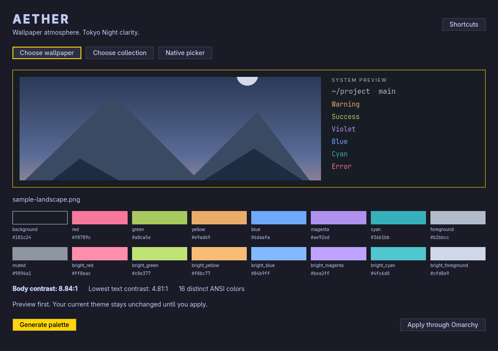

# Omarchy Aether

Wallpaper atmosphere, Tokyo Night clarity. An adaptive system theme for Omarchy 4.5, selectable from its normal **Appearance → Theme** menu. Matugen extracts the wallpaper's character; Aether builds a readable, deliberately multicolored system palette. The C++ / Qt Quick preview application is optional.

**Early development.** Previewing, indexing, and warming caches never activate a theme. Applying is explicit. This project is separate from Omarchy's packaged `aether` application and does not replace it.

## Principles

- A complete 16-color ANSI palette, not the same three Material colors assigned to every role.
- Stable red, green, amber, blue, violet, and cyan families, with bounded wallpaper harmonization.
- At least **7:1 main-text contrast on the base background**, **4.5:1 for every generated text token on base, raised, and selection surfaces**, and perceptual color-separation checks.
- Tokyo Night is the visual reference, not a promise that every stock Tokyo Night token meets these stricter requirements.
- Dark mode stays dark even when the wallpaper is bright. Monochrome images use a quiet cool-neutral foundation.
- Omarchy generates terminal and application themes from **`colors.toml`**. There are no OpenCode-specific settings or themes.

## Build and test

Requires Qt 6 base, declarative, and Wayland modules, a C++17 compiler, qmake6, make, Matugen 4.x, and libvips. The GUI uses the XDG desktop portal for file and folder selection.

```sh
bin/build
bin/test
build/omarchy-aether open
```

`bin/test` runs Qt Test offscreen, including the real QML, portal-interface injection, live theme/language updates, palette sweeps, cache identity, shuffled batches, and original-file protection. Screenshots use synthetic content; no personal wallpaper is committed.

Install as a normal Arch package and add the launcher entry:

```sh
bin/install
```

The launcher name is **Aether Palette**; the binary, package, Wayland app ID, and desktop-file ID are `omarchy-aether` to avoid colliding with the installed `aether` package.

## Preview and validate

```sh
omarchy-aether generate --image /path/wallpaper.jpg --json
omarchy-aether generate --image /path/wallpaper.jpg --output /path/colors.toml
omarchy-aether check /path/colors.toml --json
omarchy-aether open /path/wallpaper.jpg
```

For a deterministic palette without image extraction:

```sh
omarchy-aether generate --seed '#7aa2f7' --json
```

`--source-index 0` chooses Matugen's first ranked source candidate; use 1–3 to try another. Unsupported Matugen output is an error, never a silently substituted palette. Matugen always runs with **`--dry-run`**, so its own templates, reload hooks, and wallpaper setter cannot change the desktop.

All headless commands accept `--json`, exit 0 on success or 1 on failure, and report errors on stderr. A failing `check` still emits the full JSON check report. Contrast ratios describe opaque sRGB color pairs, not a certification of every application's derived/translucent colors. The color-separation floor is an engineering guardrail, not a guarantee for every form of color-vision deficiency.

### Preview-only hue-rotation experiment

The experimental branch adds an explicit option to the local development binary:

```sh
build/omarchy-aether generate --image /path/wallpaper.jpg --hue-rotation 0.5 --output /path/gentle.toml --json
build/omarchy-aether generate --image /path/wallpaper.jpg --hue-rotation 1 --output /path/stronger.toml --json
```

This rotates the existing Tokyo Night–like color families toward up to three main **sampled wallpaper hues**, rather than replacing the palette with Material colors. An explicit `--seed` uses that color as its single target instead. Surfaces, neutral text, and the accent remain byte-for-byte unchanged, so comparisons isolate the semantic-color adjustment. Distant families are untouched; regular/bright pairs rotate together. Lightness and chroma are retained unless gamut mapping or contrast requires a small correction.

Proposed full-strength rotation is bounded to 24° per role and automatically reduced until the rounded sRGB colors pass all normal checks, preserve their circular hue order and gaps of at least the greater of 28° or 65% of the original gap, retain at least 80% of every semantic pair's original perceptual distance, and retain at least 80% of their chroma. Lightness changes cannot exceed 0.025 in OKLab. Strength 0–1 selects a fraction of that safe full-strength bound; it is not a promise of a 24° change. The report measures actual hue changes after gamut mapping and hex rounding. Gray/near-neutral images retain the base colors instead of inventing a dominant hue. Sampling ignores mostly transparent pixels and uses a small sRGB preview; its targets are heuristic, not an exact census of image colors.

JSON includes the actual targets, per-role rotations, target distances, and the safety scale. **The option is accepted only by `generate`**: application, staging, the native menus, and the GUI remain on the unchanged production policy. Default generation and `--hue-rotation 0` preserve the production palette exactly. There is no setting to enable the experiment globally, and building/testing does not install it.

## Use Omarchy's normal menus

Stage a first wallpaper and palette without activating them, then explicitly enable the native Background menu integration:

```sh
omarchy-aether apply --image /path/wallpaper.jpg --stage-only --json
omarchy-aether integrate --yes --json
```

Now use **Omarchy → Appearance → Theme → Aether**. Aether is discovered from its normal user-theme directory and its generated `preview.png`; there is no separate Theme menu, custom Theme action, or need to open the GUI.

With Aether active, **Appearance → Background** opens its fast native carousel and applies the selected wallpaper with its matching system palette. When another theme is active, that same menu action delegates to Omarchy's standard background selector/setter and preserves the static theme's colors. Changing themes while the picker is open cancels application rather than unexpectedly reactivating Aether.

Integration changes the action of the existing `appearance.background` row in `~/.config/omarchy/extensions/omarchy-menu.jsonc`, carrying forward its native label, icon, and aliases because Omarchy normalizes omitted fields before merging. It preserves comments and unrelated settings, creates a dated backup, and is idempotent. Existing custom Background actions or symlink-managed menu files are protected and require an explicit manual merge. It checks the installed Omarchy menu ID before changing a real user menu; the historical `style` alias is not the `appearance` row ID. As with other explicit user-menu labels, its copied label takes precedence over stock translations.

The action fragment is bundled in the binary and provided at `integration/omarchy-menu.json`. A version-controlled personal copy may live at `~/.config/omarchy-aether/menu.json` in the universal `core/` tier of your dotfiles; `integrate` reads that preference when present. An explicit `--fragment /path/menu.json` overrides its location. Isolated integration tests can use `--config-dir /path/sandbox`.

## Fast randomized wallpaper picker

Keep the wallpaper repository separate. To fetch the full collection deliberately (several GB):

```sh
git clone --depth 1 https://github.com/JValdivia23/walls.git ~/Pictures/Wallpapers/walls
```

Index once, then warm the first batch:

```sh
omarchy-aether index ~/Pictures/Wallpapers/walls --json
omarchy-aether prepare --count 35 --preload --json
omarchy-aether pick --json
```

Or choose a collection in the GUI; it indexes the folder and prepares the first batch. To apply after making a final carousel selection:

```sh
omarchy-aether pick --apply
```

- The current wallpaper is pinned, plus **35 candidates**, or as many as the collection contains.
- A persistent shuffled deck avoids repeats until the eligible collection has been traversed.
- The native Omarchy Quickshell carousel displays cached **1536×864 JPEG previews**. Selection always returns the original file.
- After dismissal, a low-priority worker prepares and preloads the next batch. Nothing rearranges while the picker is open.
- If the next batch is not ready, the previous ready batch remains available. A cold first opening must generate its initial previews; normally run `prepare` first.
- Cache identity uses canonical source path, size, modification time, and thumbnail format. Stable aliases prevent duplicate basenames in different categories from being hidden by Omarchy's picker.
- No whole-library directory scan or palette extraction happens on a warm picker opening.
- To cache the full indexed collection progressively at low CPU priority, run `omarchy-aether warm --json`. Run `index` again after syncing or changing files.

Menu integration is opt-in through `integrate --yes`. Its shared entry point is `omarchy-aether background`; an explicitly Aether-only shortcut can use `omarchy-aether pick --apply`. Keyboard/bar integration remains opt-in: this project never shadows the `omarchy` executable, replaces a packaged plugin, or silently rebinds your keys. In particular, Alt+Space may already be used for dictation. The existing bar background button remains stock unless separately configured.

## Apply a theme explicitly

```sh
omarchy-aether apply --image /path/wallpaper.jpg --yes
```

This validates the palette, stages a new user theme at `~/.config/omarchy/themes/aether/`, and invokes **`omarchy theme set aether`**. Existing Aether directories not marked as managed by this project are protected, including earlier Surface-profile work. An explicit apply follows Omarchy's native theme application, including its normal app-refresh behavior; the GUI itself only reads the current theme.

To stage in an isolated directory without changing the desktop:

```sh
omarchy-aether apply --image /path/wallpaper.jpg --stage-only --config-dir /path/sandbox --json
```

Generated `colors.toml` is a regular runtime file, never a relative Stow symlink. Stable library images are linked; an image inside Omarchy's replaceable current-theme directory is copied into the generated theme before the switch so it cannot become a dangling link. The project does not write `/usr/share/omarchy`, edit application-specific configuration, alter original images, or install an automatic wallpaper timer.

## Storage and dotfiles

| Location | Purpose |
|---|---|
| `~/.cache/omarchy-aether/catalog.json` | Explicitly indexed source library |
| `~/.cache/omarchy-aether/thumbnails/` | Persistent image previews |
| `~/.cache/omarchy-aether/palettes/` | Matugen extraction cache, keyed by file, tool version, and palette policy |
| `~/.cache/omarchy-aether/deck.json`, `ready.json` | Shuffle position and prewarmed batch |
| `~/.cache/omarchy-aether/preparation.log` | Next-batch preparation diagnostics |
| `~/.config/omarchy/themes/aether/` | Generated theme, only after explicit staging/application |

`--cache-dir` isolates all Aether caches for tests and experiments. Project source belongs in its own repository, wallpapers in `walls`, and personal preferences/dependencies in the universal `core/` tier of your dotfiles—not a hardware profile. Generated caches and themes are not source files.

## Keyboard shortcuts

| Key | Action |
|---|---|
| `O` | Choose wallpaper through the portal |
| `C` | Choose a wallpaper collection |
| `B` | Open the native carousel |
| `Space` | Generate a preview |
| `Ctrl+Enter` | Apply, with confirmation |
| `?` | Show shortcuts |
| `Q` | Quit when idle |

There is no document editing, so undo/redo is not applicable. Generated previews remain reproducible in the cache. Applying asks for confirmation; the app cannot be closed halfway through an active operation.

The interface follows Omarchy's accent, background, foreground, rounding, locale, and layout direction live. English, Danish, and Mexican Spanish catalogs are bundled; other Omarchy languages fall back to English. Add translations under `src/i18n/` using `qsTr`/`tr` keys, and include them in `resources.qrc`.

An optional agent skill is bundled in the binary:

```sh
omarchy-aether skill install --json
```

It is never installed automatically.

## License and provenance

MIT. The app structure, live theme/language patterns, and portal request lifecycle adapt Omarchy's app templates and [Omacut](https://github.com/omacom-io/omacut), by David Heinemeier Hansson, with attribution retained in `LICENSE`. Color-space calculations implement the published OKLab transformations. Matugen and wallpaper collections are separate dependencies and retain their own licenses.
